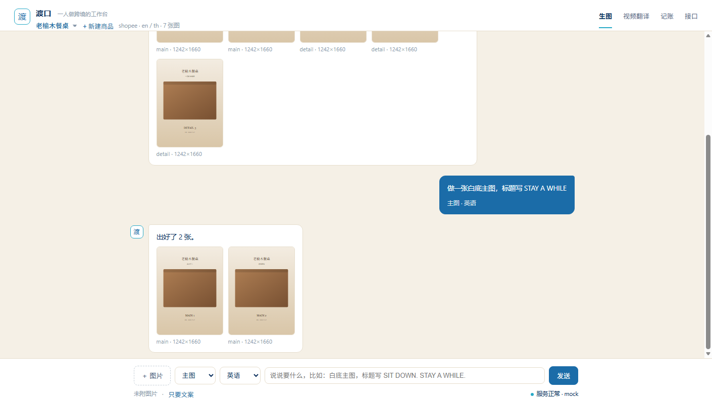
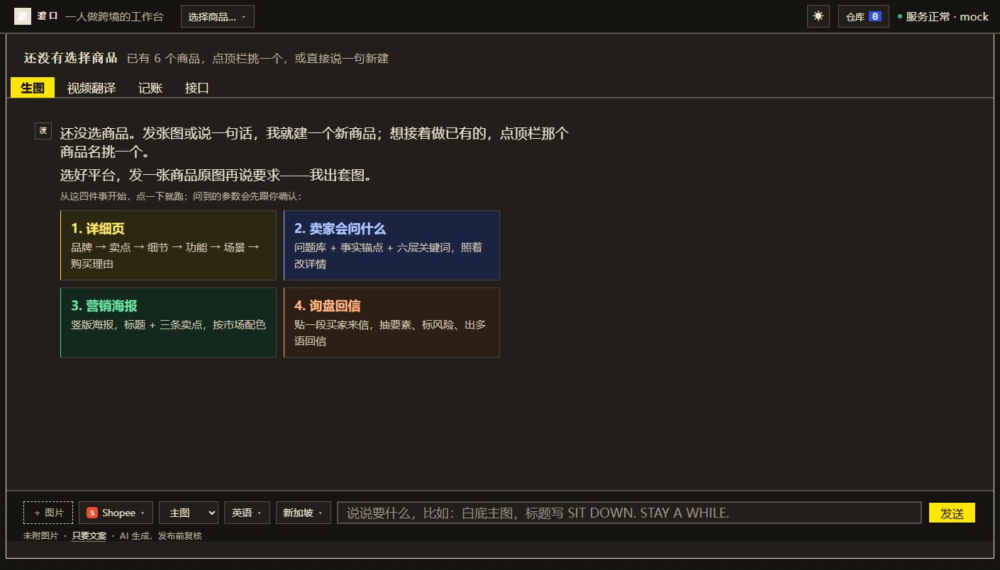

# 渡口 · 出海工作台（黑客松 S3 参赛作品）

一个人做跨境电商的辅助工作台：**拍一张图 → 出套图 → 出文案 → 上架 → 记账**。

三人队，48 小时，零依赖，克隆下来就能跑。




> 想现场讲？看 [docs/路演脚本.md](docs/路演脚本.md)（三分钟、含备用话术与出场检查）。

## 界面长什么样

没有侧栏，四个 tab 一条顶栏走完：

| tab | 谁负责 | 形态 |
|-----|--------|------|
| 生图 | 主人 | **对话框**：选平台 → 发图 + 说要求 → 出来就是套图，可以连续追问。**没有新建表单**：直接说话或发图就自动开商品，想换就说「新建商品：名字」 |
| 视频翻译 | 马 | 上传视频 → 选语言 → 出字幕表（不做 lip sync） |
| 记账 | 主人 | 记一笔 + 收入/成本/利润三张卡 |
| 接口 | 卓 | 10 个端点的作业清单，带一键自测 |
| 仓库 | 主人 | 右上角抽屉：生成过的**图片 + 文案**都在这儿，点图放大、文案一键复制 |

**平台**在输入框左边选，分两组：国内 淘宝 / 闲鱼 / 京东，海外 Amazon / eBay / Shopee / Lazada / TikTok Shop。
选中哪个，出图尺寸就按那个平台来（淘宝 800×800、Shopee 1242×1660、TikTok 1080×1920…）。

商品靠顶栏的小下拉切换；不用点按钮新建，说话就建。

## 30 秒跑起来

```bash
node --version     # 需要 ≥ 20.12（代码用了 process.loadEnvFile）
node server.mjs
# 打开 http://localhost:8790   （端口可用 PORT 环境变量改）

# 想先看看有数据的样子（另开一个终端）：
node scripts/seed-demo.mjs

# 跑一遍后端自测（mock 模式，不花钱）：
node --test test/
```

不需要 `npm install`，不需要构建。仓库里的 `package.json` 只声明 engines 与脚本，**没有任何依赖**。

## 队友怎么跑

```bash
git clone https://github.com/MYQ-gif/dukou-workbench.git
cd dukou-workbench
cp .env.example .env      # Windows: copy .env.example .env
node server.mjs           # 没有 npm install
```

默认 `AI_MOCK=1`，不填 key 也能把四条链路点一遍（出的是占位图）。
要出真图：在 `.env` 里填 `TEXT_API_KEY`（DeepSeek）与 `IMAGE_API_KEY`（火山方舟，视频共用同一把），`AI_MOCK` 改成 `0`，重启。

## 目录

```
server.mjs        集成层：路由 / 存储 / 静态服务 / 上传      （主人）
lib/ai.mjs        AI 链路：出图 / 文案 / 视频字幕            （马）
lib/jobs.mjs      任务队列：建任务 / 推进度 / 落结果          （卓）
lib/ledger.mjs    记账：加减法 + 汇总                        （卓）
web/              前端：原生 HTML/CSS/JS，无构建
CONTRACT.md       接口契约（唯一事实来源）
AGENTS.md         给三个 AI 的协作规则
data/             运行时数据（db.json + uploads/），不进 git
```

## 三个 AI 怎么配合

1. 每次开工，先让 AI 读 `AGENTS.md` + 把 `CONTRACT.md` **全文贴给它**。
2. 一个 AI 只负责一个目录，输出完整文件，不要片段。
3. 契约要改：先改 `CONTRACT.md` 并在变更记录里写一行，再改代码。

## 模式

- 默认 `AI_MOCK=1`：全部走假数据，链路能跑通（出的是占位图，文案是模板，短视频只出首帧）。
- 接真模型：复制 `.env.example` 成 `.env`，把 `AI_MOCK` 改成 `0`，四条链路各自填 key：

  ```ini
  TEXT_BASE_URL / TEXT_API_KEY / TEXT_MODEL      # 文案，默认 DeepSeek
  IMAGE_BASE_URL / IMAGE_API_KEY / IMAGE_MODEL   # 出图，默认硅基流动 Kolors
  ASR_BASE_URL / ASR_API_KEY / ASR_MODEL         # 语音识别，默认 SenseVoiceSmall
  VIDEO_BASE_URL / VIDEO_API_KEY / VIDEO_MODEL   # 商品短视频，默认火山方舟 Seedance
  ```

  重启后打开「接口」页，顶部会显示每条链路「已接 / 未配置」，点「自检」当场测通断。
  命令行版：`node scripts/aitest.mjs`（另有 `node scripts/clipcheck.mjs` 测短视频、`node scripts/contentcheck.mjs` 测内容资产与询盘、`node scripts/detailcheck.mjs` 测详情页六段）。逐步说明见 [`docs/接入AI.md`](docs/接入AI.md)。

  key 只在本机 `.env`，**永不入库、永不进前端、永不贴群**。

## 接口速查

| 方法 | 路径 | 说明 |
|------|------|------|
| GET | `/api/health` | 健康检查 |
| POST | `/api/products` | 建商品 |
| GET | `/api/products` | 商品列表 |
| GET | `/api/products/:id` | 商品详情 |
| PATCH | `/api/products/:id` | 更新商品 |
| POST | `/api/uploads` | 上传图片/视频（raw body，魔数校验） |
| POST | `/api/jobs` | 建任务 analyze/image/copy/video/clip/visual/geo/inquiry/detail |
| GET | `/api/jobs` | 任务列表（按商品/状态过滤） |
| GET | `/api/jobs/:id` | 查进度（前端 1000ms 轮询） |
| DELETE | `/api/jobs/:id` | 取消任务 |
| DELETE | `/api/assets/:id` | 软删资产 |
| POST | `/api/assets/:id/restore` | 撤销软删 |
| POST | `/api/ledger` | 记一笔 |
| GET | `/api/ledger` | 账目 + 汇总（含 `byCurrency` 分币种） |
| GET | `/api/meta` | 链路状态、市场列表、当日用量 |
| POST | `/api/meta/check` | 单链路自检（`{cap:"TEXT"}`） |

细节字段见 [`CONTRACT.md`](CONTRACT.md)（已升到 v2）。

## 安全与额度护栏

局域网/公网演示前必看：

- 写接口按 IP 滑动窗口限流，超限返回 `429 RATE_LIMITED` + `Retry-After`（本机回环默认豁免）
- 真实模式（`AI_MOCK=0`）另有额度护栏：单次出图 ≤ 6 张、当日 ≤ 120 张、当日预估花费 ≤ ¥80
- 阈值全部可用环境变量调整，清单见 CONTRACT.md 第 5 节
- 当日用量随时可查：`GET /api/meta` 的 `usage` 字段

> 注意：v2 仍然**没有登录鉴权**。真要放公网，必须先加 Bearer token + 反向代理。

## 已知限制（demo 阶段）

- 视频翻译只返回字幕样例，不出成片（48h 内不做 lip sync）
- 存储是单文件 JSON（已做原子落盘，不会半写毁库），但仍不适合多人高并发写
- 没有登录体系，作品集展示不做多租户

## 动效清单（都在真实交互上，不做装饰）

| 位置 | 动效 | 说明 |
|------|------|------|
| 新到的 AI 消息 | 文字揭示 | 段落按 55ms 递进擦出，回放历史不重播 |
| 顶栏商品按钮 → 抽屉 | 径向展开 | `clip-path: circle()` 以按钮圆心为原点 |
| 仓库成品图（详情段） | 拖拽排序 | 拖动改顺序，存 `product.detailOrder` |
| 仓库「选择」模式 | 错峰多选 | 卡片入场 26ms 递进 + 勾选 tick |
| 参数卡「要几张」 | 速度吸附滑块 | 松手按拖动速度多走一格再吸附整数 |
| 任务进度条 | 弹簧步进 | rAF 弹簧追目标值，不再一格一格跳 |
| tab / chip / 平台项 / 按钮 | 波纹 | 点击处涟漪，只给开关类控件 |
| 仓库删图 | 弧形折叠 | `clip-path + rotate` 收走后再删，6 秒内可撤销 |
| 一条消息多张图 | 横向吸附 | 三张以上改为 scroll-snap 横条，不再堆成一墙 |
| 出图落袋 | 落入 | 新图从上方压下来，仓库计数同时弹一下 |

规则：所有动效在 `prefers-reduced-motion: reduce` 下关闭；不引入渐变与光晕，uiverse 上只借手法不贴颜色。

撤销：`DELETE /api/assets/:id` 是软删（记 `deletedAt` 并从商品里摘掉），`POST /api/assets/:id/restore` 能放回去；底部提示条 6 秒内可点「撤销」。

## 实测（2026-11-25，真模型）

| 链路 | 模型 | 一次耗时 | 单价 | 状态 |
|---|---|---|---|---|
| 文案 / listing | deepseek-chat | 5–6 秒 | 约 ¥0.005 / 条 | ✅ 已接 |
| 出图 | doubao-seedream-5-0-pro-260628 | 单张 50–70 秒；3 张并发 56 秒 | ¥0.30/张（≤236 万像素档），¥0.60/张（>236 万） | ✅ 已接 |
| 商品短视频 | Seedance | 40–150 秒 | ¥1–3 / 条 | ⏳ 待填 VIDEO_API_KEY |
| 视频字幕 ASR | — | — | — | ⏳ 未配 |

出图落地细节：
- 方舟 `size` 只认 `WIDTHxHEIGHT`，且面积上限 **4,624,220 像素**，超了报 `image area must be at most 4624220 pixels`；代码会按比例缩到上限内（1856×2480 就是用满上限的结果）。
- `doubao-seedream-4-0-250828` 在控制台已标 **Retiring**，新账号可能直接 404；默认改 5.0 pro。
- 提示词默认**禁止任何文字**（模型写拉丁字母会出现乱码副标题）；只有用户明确说"标题写 X"才允许一行文字。
- 出图循环改成 3 路并发，`count=3` 墙钟 56 秒，比串行快一倍多。